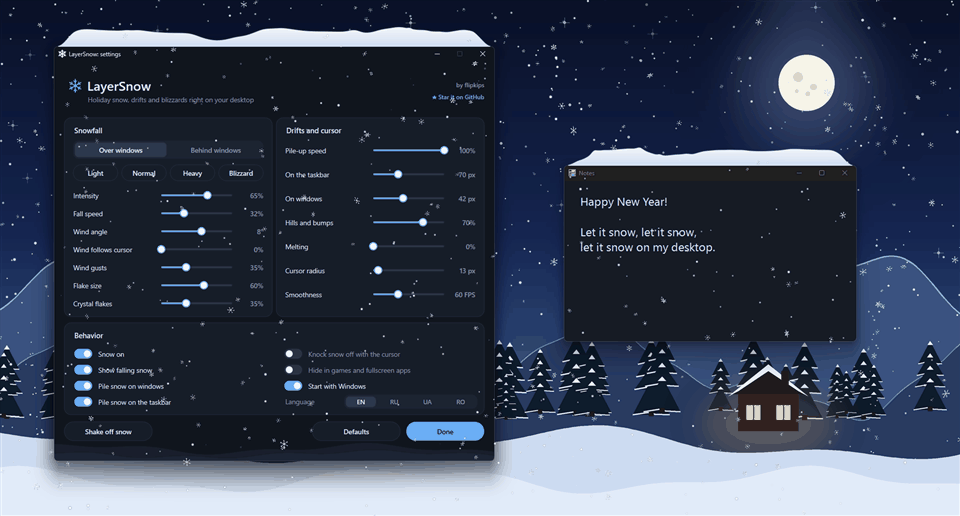
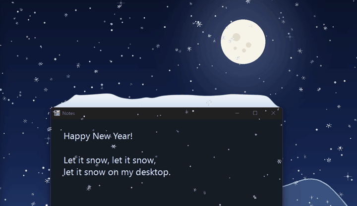
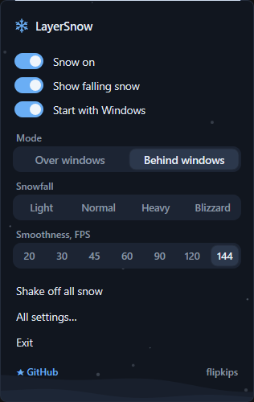
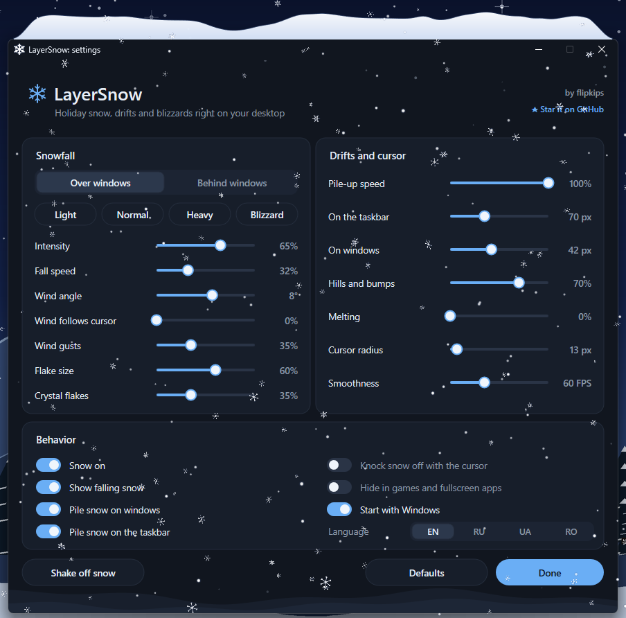

<div align="center">

# ❄️ LayerSnow

### Desktop snow overlay for Windows 10 and 11

Christmas and New Year snow right on your desktop. Snowflakes drift across your screen,<br>
settle on top of your windows and pile up into soft snowdrifts above the taskbar.

[**⬇️ Download**](../../releases/latest) &nbsp;·&nbsp; [**✨ Features**](#-features) &nbsp;·&nbsp; [**🚀 Quick start**](#-quick-start) &nbsp;·&nbsp; [**🇷🇺 По-русски**](#-по-русски)

<br>



<br>

⭐ **If LayerSnow made your desktop a little cozier, give the repo a star!** ⭐<br>
<sub>It takes one click and helps other people find a bit of winter magic.</sub>

</div>

---

## ✨ Features

### 🌨️ Snowfall

- **Soft flakes and real snowflake crystals** of four kinds that spin and tumble on their way down. You choose the mix.
- **Wind that feels alive:** set the angle and gusts, or let the wind **follow your cursor**. Move the mouse left and the snow drifts left.
- **Presets** for every mood: Light, Normal, Heavy and Blizzard.

### ⛄ Snowdrifts

- Snow **piles up on top of every window**, even on Start, search and menus, and builds a long drift **above the taskbar**.
- Drifts grow with **random hills and bumps** and taper off smoothly at window corners. Extra snow **rolls down the slope and drops off the corner**.
- **Drag a window** and its snow rides along. **Shake it** and the snow flies off. **Minimize it** and the snow is gone.
- Overlapping windows look right: snow on a window behind peeks out above the one in front.
- **Knock snow off with the cursor**, just brush through a drift.
- **Drifts only mode:** hide the falling snow and simply watch drifts build up on your windows.

<div align="center">



</div>

### 🪟 Fits your setup

- Two modes: **Over windows** or **Behind windows** (snow stays on the desktop).
- **Hides itself in games:** fullscreen and borderless windows, games that capture the mouse, and games from Steam, Epic, GOG, Riot, Ubisoft, EA, Xbox and Rockstar folders.
- Each monitor uses its own display scale, so **ultrawide 34"+, 4K and mixed setups** look consistent.
- **4 languages:** English, Русский, Українська, Română. Light and dark theme follow Windows.

### 🍃 Light and private

- Drawn on the GPU with Direct2D and DirectComposition: about **0.2% CPU** at 30 FPS, and just 10 frames per second when only drifts are on screen.
- **One small .exe**, no dependencies, **no admin rights**.
- **100% local:** no network access, no accounts, no telemetry. Settings live in `%APPDATA%\LayerSnow\settings.ini`.

---

## 🚀 Quick start

1. **Download** `LayerSnow-Setup.exe` from [**Releases**](../../releases/latest).
2. **Run it** and click **Install**. The app goes to `%LOCALAPPDATA%\Programs\LayerSnow`, admin rights are not needed.
   > 🛡️ If Windows says *"Windows protected your PC"*, click **More info** → **Run anyway**. This happens with any new unsigned app.
3. **Look for the snowflake ❄️ in the tray.** Left click opens settings, right click opens the quick menu.

That's it. Let it snow! ☃️

<table>
<tr>
<td align="center" valign="top"><b>Quick menu</b> (right click)<br><br></td>
<td align="center" valign="top"><b>Settings</b> (left click)<br><br></td>
</tr>
</table>

---

## 🎛️ What you can tune

| | |
| --- | --- |
| 🌨️ **Snowfall** | intensity, fall speed, wind angle, wind gusts, wind follows cursor, flake size, share of crystal flakes |
| ⛄ **Drifts** | pile-up speed, drift height on windows and above the taskbar, hills and bumps, melting |
| 🖱️ **Cursor** | knock snow off, cursor radius |
| 🎮 **Behavior** | over or behind windows, show falling snow, hide in games, start with Windows, language |
| ⚡ **Smoothness** | 15 to 144 FPS |

---

## ❓ FAQ

<details>
<summary><b>Windows says "Windows protected your PC"</b></summary>
<br>
LayerSnow is not code-signed yet, so SmartScreen shows a warning for any new download. Click <b>More info</b>, then <b>Run anyway</b>. The full source code is right here in the repo.
</details>

<details>
<summary><b>I see snow in my game</b></summary>
<br>
Turn on <b>Hide in games and fullscreen apps</b> in Settings → Behavior. You can also switch snow off from the tray menu in one click.
</details>

<details>
<summary><b>Will it slow down my PC?</b></summary>
<br>
No. Rendering runs on the GPU and the app follows windows through system events instead of constant polling. Typical load is around 0.2% CPU at 30 FPS. Lower the smoothness or turn off falling snow to make it even lighter.
</details>

<details>
<summary><b>Can I run it without installing?</b></summary>
<br>
Yes: <code>LayerSnow-Setup.exe /portable</code>.
</details>

<details>
<summary><b>How do I uninstall it?</b></summary>
<br>
Use <b>Settings → Apps</b>, the <b>Uninstall LayerSnow</b> shortcut in the Start menu, <code>uninstall.exe</code> in the install folder, or <code>LayerSnow-Uninstall.exe</code>.
</details>

<details>
<summary><b>Which Windows versions are supported?</b></summary>
<br>
Windows 10 version 1703 or newer and Windows 11, 64-bit.
</details>

---

## 🛠️ Build from source

You need **Visual Studio 2022 Build Tools** with the C++ workload and the Windows SDK. Python with Pillow is only needed to redraw the icon (`tools/make_icon.py`).

```bat
build.bat
```

You get `dist\LayerSnow-Setup.exe` and `dist\LayerSnow-Uninstall.exe`: the same single binary, no dependencies.

| Switch | Meaning |
| --- | --- |
| `/portable` | run without installing |
| `/uninstall` | uninstall, add `/quiet` to skip questions |

---

## 🇷🇺 По-русски

### Новогодний рабочий стол: снег на экране Windows 10 и 11

**LayerSnow** превращает рабочий стол Windows в зимнюю сказку. Снежинки падают поверх окон или за ними, оседают на окнах и над панелью задач и складываются в пушистые сугробы. Курсором снег можно сбить, а если резко тряхнуть окно, снег с него слетит.

**Как запустить**

1. Скачайте `LayerSnow-Setup.exe` в разделе [**Releases**](../../releases/latest).
2. Запустите и нажмите «Установить». Права администратора не нужны.
   > 🛡️ Если Windows покажет «Windows защитила ваш компьютер», нажмите «Подробнее», затем «Выполнить в любом случае».
3. Снежинка ❄️ появится в трее: левый клик открывает настройки, правый показывает меню.

**Полезное**

- В играх и полноэкранных приложениях снег прячется сам: тумблер «Скрывать в играх» в настройках.
- Режим «только сугробы»: выключите «Показывать падающий снег», и сугробы будут копиться без снегопада.
- Программа работает только локально, без сети и без сбора данных.
- Удаление: «Параметры» → «Приложения», ярлык «Удалить LayerSnow» в меню «Пуск» или `uninstall.exe` в папке программы.

⭐ **Понравилось? Поставьте звезду репозиторию, это очень помогает!**

---

<div align="center">

Made with ❄️ by [**flipkips**](https://github.com/flipkips) &nbsp;·&nbsp; [MIT License](LICENSE)

<sub>Happy holidays and let it snow! ☃️🎄</sub>

</div>
